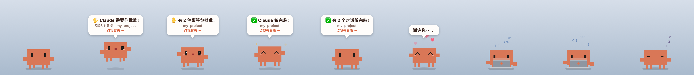

# cuteClaudePet 🦀

一只住在 macOS 桌面角落的 Claude Code 像素小螃蟹。
**Claude 需要你批准**、**有问题问你**、或者**一个对话做完了**的时候，它会跳起来挥钳子提醒你；点它就直接跳进那个对话。

*A tiny pixel-crab desktop pet for macOS that tells you when Claude Code needs your approval or a chat has finished — click it to jump straight to that chat.*



> 非官方的粉丝小项目，与 Anthropic 无关。

## 它会做什么

| 情况 | 小螃蟹 |
| --- | --- |
| Claude 要你批准（权限请求） | 跳起来轮流挥钳子、响一声，气泡写着「Claude 需要你批准！想跑个命令 · 项目名」。一直没处理会每 45 秒再叫一次（最多 3 次） |
| Claude 用 AskUserQuestion 问你 / 计划等你批准 | 同上，气泡换成「Claude 有事想问你！」/「计划写好啦」 |
| 你批准了 | `^ ^` 开心蹦跶、冒小爱心 |
| 一个对话做完了 | 欢呼一下、换个提示音，气泡「✅ Claude 做完啦！」，之后每 5 秒小跳一下等你 |
| 好几个对话在等 | 合并成「有 N 件事等你批准！」/「有 N 个对话做完啦！」 |
| Claude 正在干活 | 坐在小笔记本后面低头打字，钳子噼里啪啦，屏幕的光照在脸上，偶尔冒出 `{ }` `</>` `01` 之类的代码符号（从你发消息到对话做完；超过 10 分钟没动静会自动停） |
| 对话在 bypass 模式 | 不提醒批准（反正不用你批）；Claude 问你问题、计划等你批准时还是会提醒 |
| 你正开着那个对话 | 不打扰：在你眼前做完的不提醒；等批准的也先不响，你离开那个对话时才安静地提醒 |
| 没事的时候 | 隔一阵子（默认约 10 分钟，可在右键「溜达频率」里改成一直溜达 / 1 分钟 / 5 分钟 / 10 分钟 / 不溜达）在你放它的角落附近横着溜达一小圈（螃蟹嘛），眼睛看着前进方向；鼠标放上去就停下 |
| 5 分钟没动静 | 眯眼睡觉冒 z |

**操作**

- **单击**：有提醒时直接打开那个对话（Claude 桌面版用 `claude://code/continue?session=…` 跳到具体对话；终端里的 Claude Code 会把终端叫到前面）。多个对话做完时，每点一下跳一个。没提醒时点它会撒娇。
- **拖动**：放到哪都行，会记住位置，之后就在那附近溜达。
- **右键**：试一下提醒 · 清除当前提醒 · 对话做完了也提醒我 · 正在看的对话就不提醒 · 静音 · 平时躲起来只在需要你时出现 · 溜达频率 · 回到右下角 · 下班。

## 安装

需要 macOS 12+ 和 Xcode Command Line Tools（`xcode-select --install`）。

**1. 克隆到固定位置并编译**（钩子写死了这个路径）

```bash
git clone https://github.com/Elidornier/cuteClaudePet.git ~/.claude/approval-pet
```

```bash
~/.claude/approval-pet/build.sh
```

**2. 把钩子加进 Claude Code 设置**

如果你还没有 `~/.claude/settings.json`：

```bash
cp ~/.claude/approval-pet/hooks.json ~/.claude/settings.json
```

如果已经有了，用这条把钩子合并进去（保留你原来的设置和钩子）：

```bash
cd ~/.claude && jq -s '.[0] as $s | .[1].hooks as $h | $s | .hooks = (reduce ($h | keys[]) as $k (($s.hooks // {}); .[$k] = ((.[$k] // []) + $h[$k])))' settings.json approval-pet/hooks.json > settings.json.new && mv settings.json.new settings.json
```

**3. 试一下**

```bash
~/.claude/approval-pet/ApprovalPet.app/Contents/MacOS/ApprovalPet demo
```

之后每次开始 Claude Code 会话时，小螃蟹会自己出现。

## 它是怎么工作的

- `hooks.json` 给 Claude Code 注册了一组 **async 钩子**（不会拖慢 Claude）：`PermissionRequest`、`Notification`、`PreToolUse`（AskUserQuestion / ExitPlanMode）记录「需要你」；`PostToolUse`、`UserPromptSubmit`、`Stop` 等清除提醒；`Stop` 同时留下「做完啦」；`UserPromptSubmit` 和每次工具调用标记「正在干活」。
- 钩子调用 `ApprovalPet hook`，它把每个等待中的对话写成 `pending/` 里的一个小 JSON 文件（会话 ID、工具名、项目名、桌面对话 ID）。
- 桌面宠物 `ApprovalPet.app`（无 Dock 图标的浮动小窗口）每 0.4 秒看一眼 `pending/`，决定心情和气泡。
- 「你正在看哪个对话」：Claude 桌面版在 `~/Library/Logs/Claude/main.log` 里记录 `setFocusedSession: sessionId=local_…`，小螃蟹读这行，再加上 Claude 是否在最前面、你最近 2 分钟有没有动键盘鼠标来判断。这是 App 的内部日志格式，以后 App 更新可能会变；变了的话只是退回到「照常提醒」。
- 所有东西都在本机，不联网。`events.log` 记录最近收到的钩子事件，方便排查。

```text
ApprovalPet              运行小螃蟹（通常由钩子自动 open）
ApprovalPet hook         钩子入口（从 stdin 读钩子 JSON）
ApprovalPet demo         假装有个批准请求（8 秒后消失）
ApprovalPet demo-done    假装有个对话做完了
ApprovalPet demo-work    假装 Claude 在干活
ApprovalPet clear        清除所有提醒
ApprovalPet status       看看小螃蟹认为你正在看哪个对话
ApprovalPet snapshot F   把各种状态画成一张 PNG
```

改完 `src/main.swift` 后重新跑 `./build.sh`，再右键让小螃蟹下班、重新运行即可。

## 卸载

1. 右键小螃蟹 →「下班」。
2. 从 `~/.claude/settings.json` 里删掉调用 `approval-pet` 的那些钩子。
3. 删除 `~/.claude/approval-pet`。
